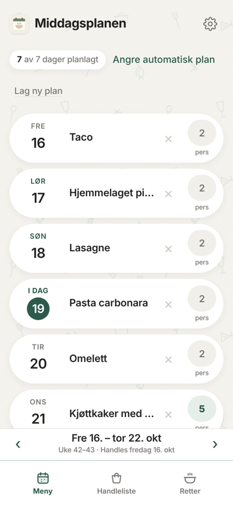
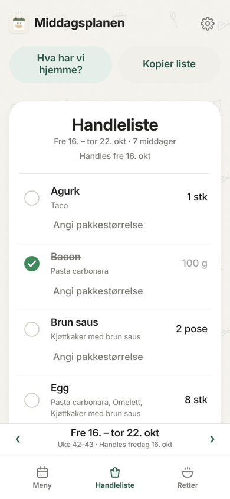
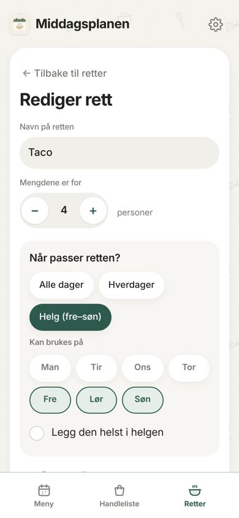
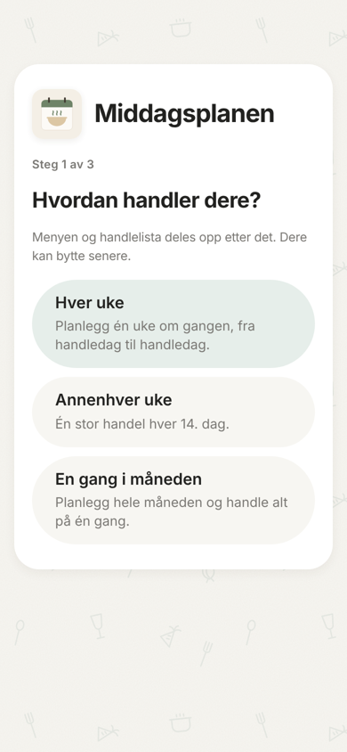
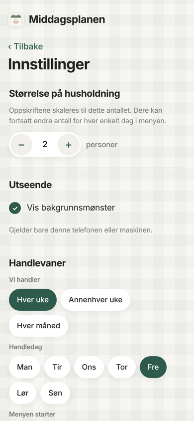

<p align="center">
  
</p>

<h1 align="center">Middagsplanen</h1>

<p align="center">
  Planlegg middagene for uka eller måneden, og få handlelista regnet ut automatisk.<br>
  Delt med hele husstanden, rett på telefonen.
</p>

<p align="center">
  <a href="https://evenkleppa.github.io/middagsplanlegger/"><b>Åpne appen →</b></a>
</p>

<p align="center">
  
  
  
</p>

> Appen er ny og blir oppdatert underveis. Tilbakemeldinger er velkomne.

---

## Hva appen gjør

### Meny for den perioden som passer dere
- Velg om dere handler **hver uke, annenhver uke eller en gang i måneden** når dere lager bruker. Velg også hvilken **dag dere handler**, og om menyen starter samme dag eller dagen etter.
- Menyen viser riktige **ukenumre**, og åpner på **dagens dato**, så dere ser kveldens middag med en gang.
- Dere kan bytte frekvens når som helst under **Innstillinger**, for eksempel fra to uker til måned. Ingenting slettes.

### Appen lager menyen, eller dere velger selv
- Trykk **«Fyll tomme dager»**, så foreslår appen retter for resten av perioden.
- Dere kan også velge retter selv for enkeltdager og la appen fylle ut resten.
- Den samme retten kommer ikke for tett, og appen husker reglene for hver rett.
- Når dere velger en rett selv, ser dere **hvor mange ganger den allerede ligger i menyen**. Det er ekstra nyttig ved månedshandling.
- Endret dere mening? **Angre** setter planen tilbake.

### Retter dere kan tilpasse
- Nye husstander får rundt **20 vanlige middagsretter** med ferdige ingredienser. Mengdene kan justeres, og rettene kan slettes.
- Det er enkelt å **legge til egne retter**.
- Hver rett kan begrenses til bestemte dager, for eksempel **bare i helgen** eller **bare hverdager**. Retten kan også merkes med at den **helst bør legges i helgen**.

### Riktig antall personer
- Velg **størrelsen på husholdningen** én gang, så skaleres alle oppskriftene.
- Får dere besøk en dag, kan dere endre **antall personer for akkurat den dagen** i menyen.

### Handlelista regnes ut for dere
- Appen legger sammen ingrediensene fra alle rettene i perioden, for eksempel 1,2 kg kjøttdeig, og regner om til **antall pakker**.
- Under **«Hva har vi hjemme?»** legger dere inn det dere allerede har, så trekkes det fra.
- Huk av varene mens dere handler, eller kopier lista til en melding.

### Delt med husstanden
- Alle i samme husstand ser den samme menyen og handlelista. Endringer dukker opp på den andre telefonen **med en gang**.
- Del husstandskoden fra Innstillinger, så kan resten av familien bli med.

---

## Kom i gang

1. Åpne **[evenkleppa.github.io/middagsplanlegger](https://evenkleppa.github.io/middagsplanlegger/)** og trykk **Ny her? Opprett bruker**.
2. Velg **Opprett husstand**. La «Start med forslag til vanlige middagsretter» stå på hvis dere vil ha retter å starte med.
3. Svar på hvordan dere handler og hvor mange dere er.
4. Trykk **«Fyll tomme dager»**, eller velg rettene selv.
5. Vil dere være flere? Åpne **Innstillinger** (tannhjulet), kopier **husstandskoden** og send den til de andre. De lager egen bruker og velger **Bli med i en husstand**.

### Legg appen på hjemskjermen
- **iPhone:** åpne adressen i Safari, trykk på Del-knappen og velg **Legg til på Hjem-skjerm**.
- **Android:** åpne adressen i Chrome, trykk på ⋮ og velg **Installer app**.

Appen får da sitt eget ikon og åpnes i fullskjerm, som en vanlig app.

<p align="center">
  
  
</p>

---

## Personvern

Hver husstand ser bare sine egne data. Retter, menyer og handlelister lagres i en database hos Supabase, beskyttet av tilgangsregler. Koden i dette repoet er offentlig, men det er ikke dataene dere legger inn.

---

## For utviklere: sett opp din egen kopi

<details>
<summary>Trykk for å se oppsettet (rundt 15 minutter)</summary>

### Det du trenger
- En GitHub-konto
- En Supabase-konto med et prosjekt (gratisplanen holder)

### 1. Sett opp databasen i Supabase
1. Åpne prosjektet ditt på supabase.com.
2. Gå til **SQL Editor** og trykk **New query**.
3. Lim inn alt fra `supabase/schema.sql` og trykk **Run**. Nederst skal det stå «Success. No rows returned».

Dette lager tabellene, tilgangsreglene og sanntidsoppdateringen mellom telefonene.

### 2. Legg inn adressen og nøkkelen
1. I Supabase trykker du **Connect** eller går til **Project Settings → API Keys**.
2. Kopier **Project URL** og den offentlige nøkkelen (**anon public** eller **publishable**). Bruk aldri **service_role** eller **secret**.
3. Lim dem inn i `config.js`:

```js
window.MIDDAG_CONFIG = {
  supabaseUrl: "https://abcdefgh.supabase.co",
  supabaseAnonKey: "eyJhbGciOi..."
};
```

Den offentlige nøkkelen er laget for å ligge i nettleseren. Det er tilgangsreglene som beskytter dataene.

### 3. Legg ut appen med GitHub Pages
1. Last opp alle filene til et offentlig repo.
2. Gå til **Settings → Pages**, velg **Deploy from a branch**, **main** og **/ (root)**, og trykk **Save**.
3. Etter et par minutter ligger appen på `https://BRUKERNAVN.github.io/REPONAVN/`.

### 4. Fortell Supabase hvor appen ligger
1. Gå til **Authentication → URL Configuration**.
2. Sett **Site URL** til adressen fra steg 3, og legg den samme adressen til under **Redirect URLs**.
3. **Anbefalt:** skru av **Confirm email** under **Authentication → Sign In / Providers → Email**. Supabase sin innebygde e-post kan bare sende noen få e-poster i timen.

### Oppdateringer
Last opp nye filer til repoet. GitHub Pages oppdaterer seg i løpet av et par minutter, og telefonene får den nye versjonen neste gang appen åpnes. Brukernes data ligger i Supabase og blir ikke berørt.

Endringer i `data/startdata.json` gjelder bare husstander som opprettes etterpå.

### Filene

| Fil | Hva den er |
|---|---|
| `index.html` | Selve appen |
| `config.js` | Adressen og nøkkelen til Supabase |
| `supabase/schema.sql` | Databasen og tilgangsreglene, kjøres én gang |
| `data/startdata.json` | Startpakken med vanlige middagsretter for nye husstander |
| `manifest.webmanifest`, `sw.js`, `icons/` | Gjør at appen kan installeres på telefonen |
| `docs/` | Skjermbildene i denne beskrivelsen |

</details>

---

<p align="center"><sub>Utviklet av Even Kleppa</sub></p>
